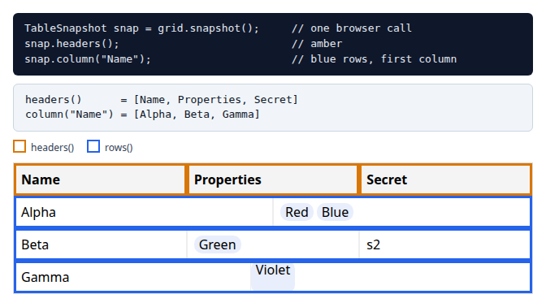
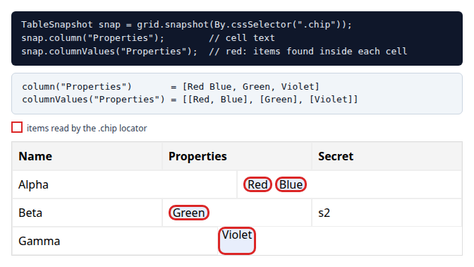
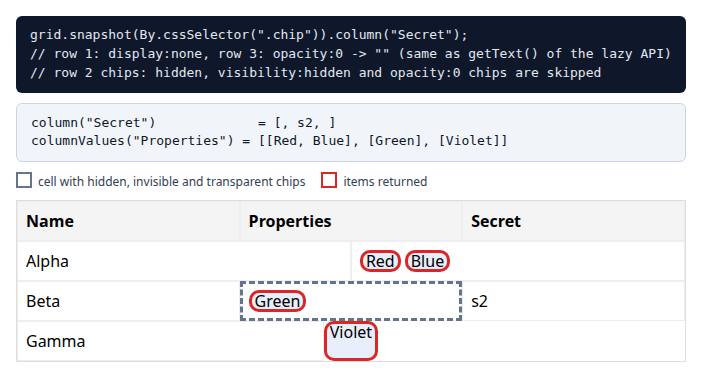
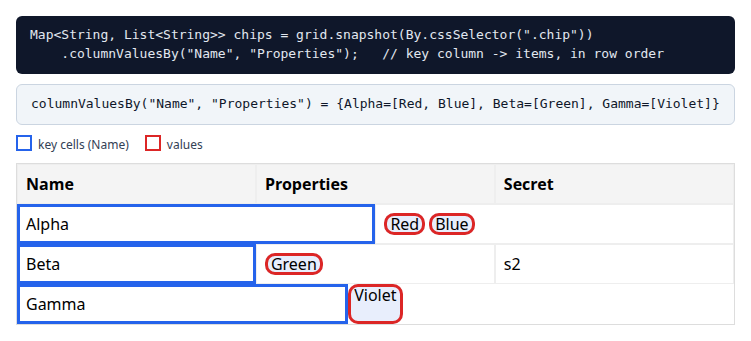
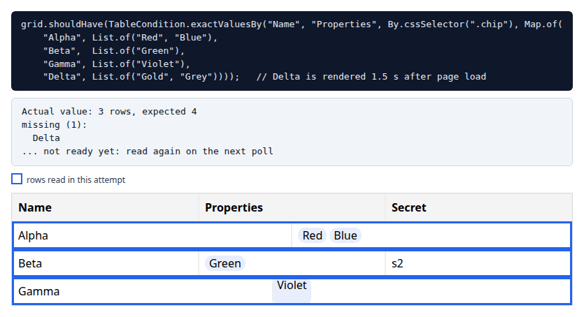
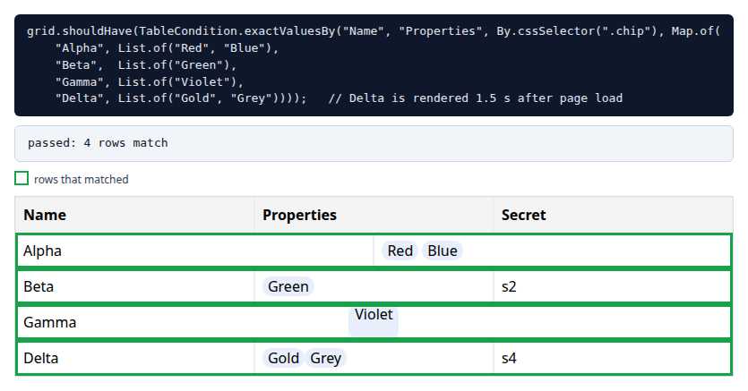
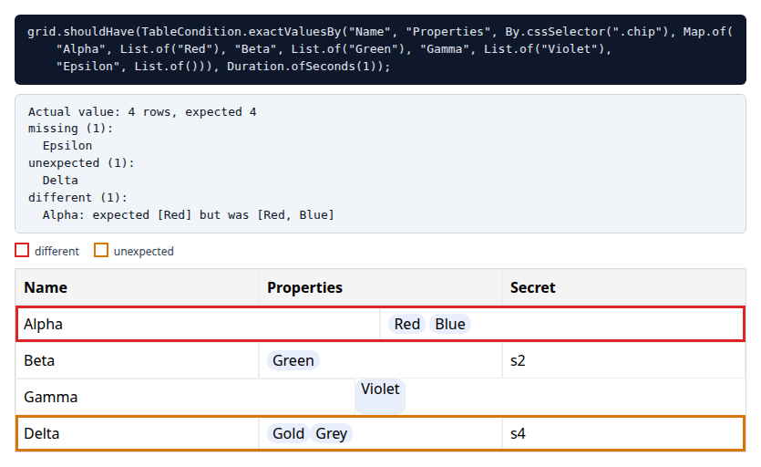
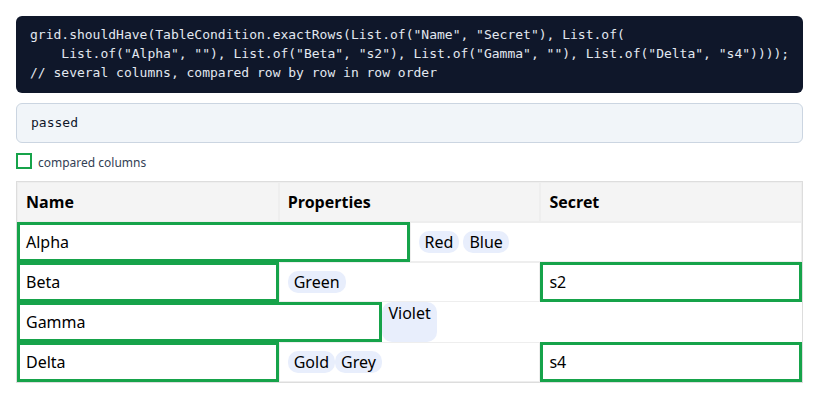
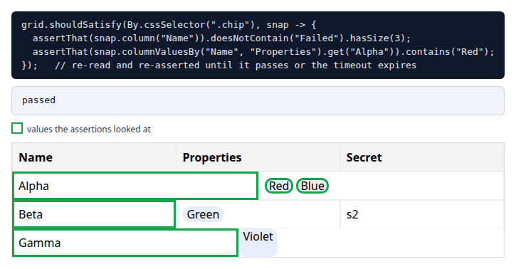
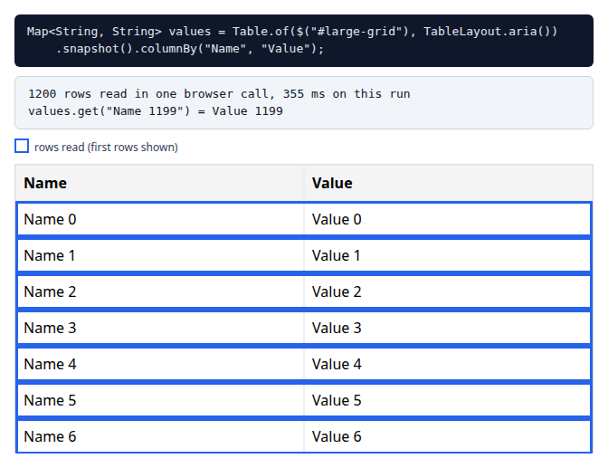

# Bulk read and whole-table checks

The table helper in `dev.quokkify.elements.table` (see [Table API](table-api.md)) reads a table lazily, element by
element. That costs about ten WebDriver round trips per row: a check over 400 rows took 28–32 s in issue #895. The
bulk API reads the **whole table in one browser call** and builds on that:

1. **`snapshot()`**: headers, every row's cell texts and, optionally, the items inside each cell (chips, tags), as
   plain immutable data;
2. **`shouldHave(TableCondition)`**: compares the whole table and waits like any Selenide `should*`. A mismatch is
   reported as a short diff, not 400 rows;
3. **`shouldSatisfy(assertions)`**: runs your AssertJ assertions on a fresh snapshot until they pass.

Each check attempt costs one root lookup plus one script call, whatever the number of rows. Header lookup follows
the usual rules of the helper: exact text after whitespace normalization, and `TableColumnException` when a header is
`not found` or `ambiguous`.

The screenshots below are taken by real Selenide runs against the test fixture
`tools/environment/assets/nginx/html/table-model-contract/snapshot.html`. Every example is executed and asserted by
`TableBulkDocExamplesTest`, which also produces these images. Each image shows the code, what it returned, and the
elements involved: **amber** for headers, **blue** for rows or key cells, **red** for items or differences, and
**green** for what a passing check compared.

## API

| Type             | Methods                                                                                                                                                            |
| ---------------- | ------------------------------------------------------------------------------------------------------------------------------------------------------------------ |
| `Table`          | `snapshot()`, `snapshot(By items)`, `shouldHave(TableCondition[, Duration])`, `shouldSatisfy([By items,] Consumer<TableSnapshot>[, Duration])`                     |
| `TableSnapshot`  | `headers()`, `rows()`, `column(header)`, `columnValues(header)`, `texts(List<String> headers)`, `columnBy(keyHeader, header)`, `columnValuesBy(keyHeader, header)` |
| `SnapshotRow`    | `cells()`, `cell(int index)`, `cell(String header)`                                                                                                                |
| `SnapshotCell`   | `text()`, `values()` (texts of the items found inside the cell; empty without an items locator)                                                                    |
| `TableCondition` | `exactRows(List<String> headers, List<List<String>> rows)`, `exactValuesBy(keyHeader, valuesHeader, By items, Map<String, List<String>>)`                          |

All examples use this ARIA grid, where each **Properties** cell holds a list of chips:

```java
Table grid = Table.of($("#chip-grid"), TableLayout.aria());
By chip = By.cssSelector(".chip");
```

## 1. Read the whole table once

```java
TableSnapshot snap = grid.snapshot();
snap.headers();         // [Name, Properties, Secret]
snap.column("Name");    // [Alpha, Beta, Gamma]
snap.rows().get(1).cell("Secret").text();   // s2
```

A snapshot is a point-in-time read. It waits for the table root to exist, but not for rows. To verify data, use the
checks in sections 5–8, which wait.



## 2. Items inside a cell (chips, tags)

Pass a locator for the items. It is evaluated inside every cell, in the same browser call:

```java
TableSnapshot snap = grid.snapshot(chip);
snap.columnValues("Properties");   // [[Red, Blue], [Green], [Violet]]
```

Do not split `text()` on line breaks. Whether chips are separated by `\n` or by spaces depends on the page's CSS
(flex or inline), and the item locator does not depend on it.



## 3. Hidden elements read like `getText()`

Visibility follows Selenium's rules, so a snapshot agrees with the lazy API on the same DOM:

- **Cells.** A hidden cell reads as `""`. Hidden means `display: none` or `hidden`, `visibility: hidden`, or
  `opacity: 0`, on the element or an ancestor.
- **Items.** Hidden items are skipped.
- **Text.** Text of hidden descendants is left out of a cell's text.
- **`display: contents`.** An element with `display: contents` counts as visible when any of its children is.

```java
grid.snapshot(chip).column("Secret");   // ["", "s2", ""]: row 1 display:none, row 3 opacity:0
```



## 4. A column keyed by another column

```java
Map<String, List<String>> chips = grid.snapshot(chip).columnValuesBy("Name", "Properties");
// {Alpha=[Red, Blue], Beta=[Green], Gamma=[Violet]}

Map<String, String> secrets = grid.snapshot().columnBy("Name", "Secret");
```

The maps keep row order and are unmodifiable. Keys must be unique: a row with no key cell, or a repeated key, throws
`IllegalStateException` naming the rows.



## 5. Check the whole table, with waiting

```java
grid.shouldHave(TableCondition.exactValuesBy("Name", "Properties", chip, Map.of(
    "Alpha", List.of("Red", "Blue"),
    "Beta", List.of("Green"),
    "Gamma", List.of("Violet"),
    "Delta", List.of("Gold", "Grey"))));
```

The Delta row is rendered 1.5 s after page load. Every attempt reads the table again, and the check passes as soon
as the data matches. No separate `rows().shouldHave(...)` wait is needed.

- **Order.** Keys may come in any row order; items within a cell are compared in displayed order.
- **Timeout.** The default is Selenide's timeout; pass a `Duration` as the second argument to change it.
- **Failure.** A failing check throws a Selenide `ElementShould` on the table root, with the usual screenshot, report
  step and soft-assert support.

Left: the first attempt, while Delta is not rendered yet. Right: the check has passed.

 

## 6. A failure you can read on 400 rows

The failure message lists only the differences, at most 10 per section, followed by `... N more`:

- missing keys, in the order of the expected map;
- unexpected keys and changed values, in row order.

```java
grid.shouldHave(TableCondition.exactValuesBy("Name", "Properties", chip, Map.of(
    "Alpha", List.of("Red"), "Beta", List.of("Green"), "Gamma", List.of("Violet"),
    "Epsilon", List.of())), Duration.ofSeconds(1));
```

```
Actual value: 4 rows, expected 4
missing (1):
  Epsilon
unexpected (1):
  Delta
different (1):
  Alpha: expected [Red] but was [Red, Blue]
```



## 7. Several columns, row by row

`exactRows` compares the texts of the given columns row by row, in row order. A cell missing from a short row reads
as `""`, the same as an empty cell.

```java
grid.shouldHave(TableCondition.exactRows(List.of("Name", "Secret"), List.of(
    List.of("Alpha", ""), List.of("Beta", "s2"), List.of("Gamma", ""), List.of("Delta", "s4"))));
```

Rows are compared by position, so one inserted row shows up as many `different` rows. The first line of the failure
message gives both row counts.



## 8. Any check with AssertJ

For anything other than whole-table equality, write ordinary AssertJ assertions over the snapshot. They are re-read
and re-run until they pass:

```java
grid.shouldSatisfy(chip, snap -> {
  assertThat(snap.column("Name")).doesNotContain("Failed").hasSize(3);
  assertThat(snap.columnValuesBy("Name", "Properties").get("Alpha")).contains("Red");
});
```

These failures count as "not ready yet" and are retried:

- a failed assertion;
- a header that is not displayed or is ambiguous;
- a row or cell that is not rendered (`IndexOutOfBoundsException`, `NoSuchElementException`);
- a key column with a missing cell or a repeated key.

Any other exception fails the check at once, as itself. For example, `Integer.parseInt` on a cell that still shows
"Loading…" throws `NumberFormatException`, so a bug in the test surfaces immediately and does not wait out the
timeout. On a timeout the actual value is the last AssertJ message. For whole-table equality on large tables, prefer
a `TableCondition` and its short diff.



## 9. Large tables

```java
Map<String, String> values = Table.of($("#large-grid"), TableLayout.aria())
    .snapshot().columnBy("Name", "Value");   // 1200 rows
```

1200 rows are read in one browser call. The screenshot shows the time measured on that run. Reading the same data
row by row through `TableRow.cell(header)` costs about ten round trips per row.



## 10. Errors

```
snap.column("Region")                → TableColumnException: Column "Region" not found in {#chip-grid}; displayed headers: [Name, Properties, Secret]
snap.column("Company")               → TableColumnException: Column "Company" ambiguous in {#repeated-table}; displayed headers: [Country, Company, Company]
snap.rows().get(1).cell("Secret")    → NoSuchElementException: row 1 has 1 cells, no cell for header "Secret" in {#t}   (short row)
snap.columnValuesBy("Name", "Tags")  → IllegalStateException: rows 0 and 2 both have "Alpha" in key column "Name" of {#t}
snapshot() with By.id / By.name      → UnsupportedOperationException: snapshot() supports By.xpath and By.cssSelector, got: By.id: r
```

When used inside `shouldHave` or `shouldSatisfy`, the first four fail the attempt and are retried. After the timeout,
the `ElementShould` message contains their text. An unsupported locator fails before the browser is called.

## Which one to use

| You want to                                               | Use                                                               |
| --------------------------------------------------------- | ----------------------------------------------------------------- |
| check one column of an XPath layout, with waiting         | `table.column(h).shouldHave(exactTexts(...))` (already one call)  |
| check a whole table: key column to items, or aligned rows | `table.shouldHave(TableCondition.exactValuesBy / exactRows(...))` |
| any other check over the data, with waiting               | `table.shouldSatisfy(snap -> assertThat(...))`                    |
| read the data once, for custom logic                      | `table.snapshot()` / `snapshot(By items)`                         |
| act on a row or cell (click, type), or a small table      | the lazy API: `row(column, value).cell(header)`                   |

## Matching rules and limitations

- Texts and headers are whitespace-normalized: runs of whitespace and NBSP collapse to one space, and the result is
  trimmed. Write expected texts with single spaces.
- Locators of the layout and the items locator must be `By.xpath` or `By.cssSelector`.
- Only rows mounted in the DOM are read. A virtualized grid returns the rows currently rendered.
- Values are read as visible text: an `<input>` or `<select>` in a cell reads as `""`.
- `colspan` / `rowspan` are not modelled, as in the rest of the helper.
